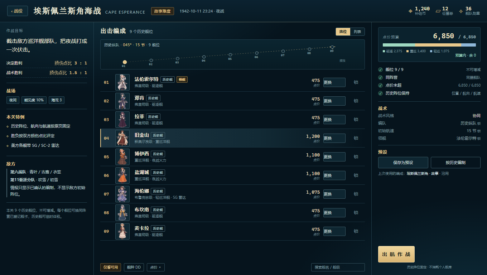
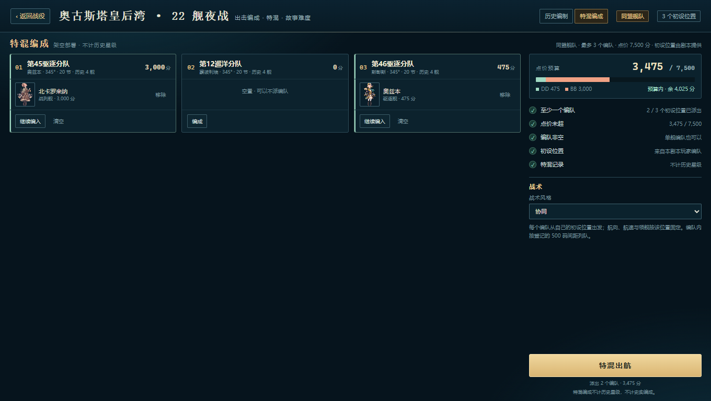
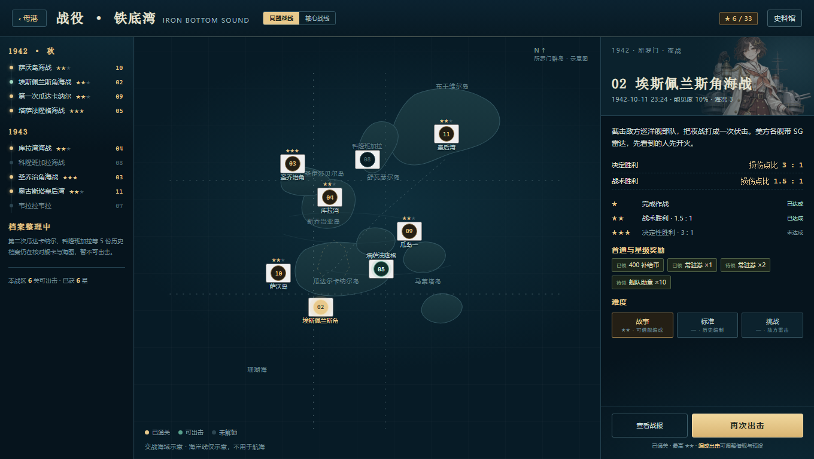

# CAS 体验重设计 v1

> 对象：CAS 当前前端（`client/src`）、战役/剧情/经济/编队与战斗交互。
> 定位：二次元海战指挥游戏，战斗内核为 CAS 五版实时改编。
> 对标：碧蓝航线（收藏、情感、养成节奏）× 明日方舟（信息克制、关卡结构、编队决策）。
> 本文只做设计，不改任何 CAS 舰卡、表值、历史阵位或裁决。

---

## 0. 结论先行

CAS 现在最短的板，不是战斗内核，也不是立绘。是**中间那层产品层**：

- 把 CAS 的硬规则，翻译成玩家每一步能做的决定；
- 把 167 个可征募身份，变成“我想把她编进舰队”的理由；
- 把 11 个历史想定，变成一条“我还想打下一关”的航线。

三个最高杠杆的改动：

1. **把关卡前编成做成一个真正的屏幕**，而不是作战简报里的 9 个下拉框。
   它是“看内容”到“打内容”的必经之路，也是收藏、经济、战役、战术风格的唯一交汇点。
2. **统一经济**：离线也要有完整舰库、同一套征募与兑换。
   否则战役奖励的补给币、征募券、勋章全都没有去处，收藏循环是断的。
3. **把战斗的“暂停 → 预令 → 撤销”做成默认节奏**。
   实时指挥不该是手忙脚乱，而该是“想清楚，再按开始”。

如果这一版只做一件事：**做编成**。它是当前最像数据库表单、最不像游戏的地方。

---

## 1. 现状诊断

### 1.1 八个具体问题

| 区域 | 现状（证据） | 玩家感受 | 根因 |
| --- | --- | --- | --- |
| 母港 | “初航训练计划”和“登舰上课”指向同一处；钱包 0/0/0 无引导；底部写“2000/5000 分对战”，点表实际是 3000/10000；无“继续上次” | 不知道先点哪；资源是死的 | 移植了原作的版式，没有重做信息优先级 |
| 战役 | 11 个关卡里 6 个可出航，其余 5 个以“待规则核验”直接出现在主列表；列表不显示星级、奖励、目标；难度是全局的 | 像在看开发后台 | 把“资料核验状态”当成了玩家信息架构 |
| 简报/编成 | 9 个 `<select>` 竖排；没有立绘、角色、阵位、舰种定位；“出航作战”在配置之前；史料审计占据主流程（`CampaignArchive.tsx` 412–442 行） | 在填表，不是在编队 | 编成没有独立设计，只是简报里的一个字段组 |
| 舰库/编队 | 本地只有 4 个舰型、3 个下拉（阵营/领舰/风格）；线上编队是两栏文字列表；没有“编成”概念 | 没有“我的舰队” | 收藏系统只做了壳，没接编队 |
| 战斗 | 4 个页签下堆了约 20 个条件区块；手势不可发现；无自动暂停、无撤销、无预令；仅三个主样式表就有 61 处 9–11px 字号 | 一开战就慌 | 把“所有功能”都放在同一层可见 |
| 经济 | 本地 4 舰型 vs 线上 210 个身份/167 可征募；本地补给币只有“500 周券”一个出口（AI 用勋章）；本地存档没有按身份的舰船所有权（`plan.md` 待办） | 奖励没有意义 | 两条经济线各做各的 |
| 剧情 | 只有一张章节卡片；无 VN 播放器规范；无章节奖励/回顾；60% 屏幕是空的（`StoryMode.tsx`） | 像一个占位页 | 剧情只接了序章场景，没做“模式” |
| 组件 | 每屏一套 CSS；钱包/页头/页签至少 4 套实现；术语不统一（母港/港口、征募/招募、编队/编成） | 每个页面像不同游戏 | 没有设计系统和共享组件 |

另外两个**必须点名的数据问题**：

- **星级分母是 3，但评级只产出 0/2/3**（`campaign-progress.ts` 的 `campaignStars`）。
  1 星奖励实际是“首通奖励”。玩家看到 2 星通关却领到“首通补给”，语义是错的。
  建议：要么评级改成 1/2/3 三档，要么把“首通”从星级奖励里拆出来单独展示。
- **“故事难度”同时承担了两种语义**：AI 更协同 + 可按点价借舰编成。
  玩家在难度页签上只看到“故事/标准/挑战”，不知道它同时改变了编成规则。

### 1.2 根因只有一句话

> 项目把“资料核验”和“移植原作页面”当成了产品层，但玩家要的是**决策、反馈、收藏和下一步**。

---

## 2. 对标拆解：学什么，不学什么

| 维度 | 碧蓝航线 | 明日方舟 | CAS 应该拿什么 |
| --- | --- | --- | --- |
| 核心循环 | 建造 → 编队 → 推图/活动 → 养成 → 再建造 | 抽卡 → 编队 → 推图 → 养成/基建 → 再抽卡 | 征募 → 编成 → 战役 → 舰历/收藏 → 再征募 |
| 编队 | 前排/后排，6+6，角色分工清晰 | 12 人编队 + 支援，费用/职业/阻挡一眼可读 | **历史舰位 + 同阵营换舰 + 点价预算**，这是 CAS 独有的钩子 |
| 关卡 | 海图节点、掉落、三星 | 章节 → 关卡 → 三星条件 → 代理指挥 | 战线 → 战区 → 关卡节点；三星条件前置；战后“下一关” |
| 剧情 | 立绘 + 对话 +  CG，活动叙事 | VN 播放器（自动/跳过/记录）+ 剧情关 | 独立剧情模式 + 标准 VN 播放器 + 战斗插入 |
| 经济 | 建造/兑换/委托/后宅 | 合成玉/源石/凭证/基建 | 补给币/征募券/舰队勋章 + **不卖数值的横向成长** |
| 养成 | 等级/技能/装备/好感 | 等级/精英化/模组/信赖 | **舰历（非数值）**：语音、档案、涂装、预设位 |
| 视觉 | 高饱和、角色优先 | 低饱和、信息优先 | **海军部海图室**：深蓝 + 黄铜 + 水彩立绘，克制 |
| 节奏 | 活动驱动、日常轻 | 理智驱动、周常重 | **周常驱动 + 无体力**，尊重硬核玩家的时间 |

三条取舍，必须先拍板：

1. **学方舟的信息克制，不学方舟的理智。**
   CAS 的受众是愿意花 40 分钟打一场海战的人。体力会赶走他们。用周常上限而不是体力。
2. **学碧蓝的收藏情感，不学碧蓝的数值膨胀。**
   CAS 舰卡不能改。收藏的回报必须是语音、档案、涂装、编成位、称号，而不是炮击值。
3. **保留 CAS 的海图指挥，不把它做成自动战斗。**
   自动战斗可以做为“已通关关卡的重演/刷取”后置功能，但不能成为主体验。

一句话定位：

> **用明日方舟的信息结构做外层，用碧蓝航线的收藏情感做粘性，用 CAS 的海图指挥做唯一性。**

---

## 3. 设计原则

1. **双层时间观**：外层慢慢玩（母港、收藏、剧情、编成），内层紧张打（实时海战）。两层不混。
2. **规则是内容，不是门槛**：CAS 数据放在“档案/史料”层；玩家层只说人话。
3. **收藏不卖数值**：所有成长都是横向的，CAS 舰卡与点表不动。
4. **一切可撤回**：实时指挥必须有暂停、预令、撤销；误点不能是致命的。
5. **一屏一决策**：每个屏幕只有一个主按钮，其余都是次要动作。
6. **数据有出处，界面说人话**：每个数字都能在档案里找到来源；主界面不出现“PDF 第 65 页”。

---

## 4. 信息架构与导航

### 4.1 目标结构

```text
登录
└─ 母港（单页）
   ├─ 作战桌
   │  ├─ 剧情模式 ── 章节 ── 剧情节点 / 战斗节点
   │  ├─ 战役 ── 战线 ── 战区 ── 关卡 ── 简报 ── 出击编成 ── 战斗
   │  ├─ 越级挑战 ── 挑战编成 ── 战斗
   │  └─ 自由演习 ── 演习设置 ── 战斗
   ├─ 舰库与编成
   │  ├─ 舰船收藏（图鉴）
   │  ├─ 舰队预设（可命名、可复制）
   │  └─ 舰船详情（立绘 / 档案 / 舰历 / 语音）
   ├─ 征募与补给
   │  ├─ 征募（常驻 / 限定 UP / 保底 / 兑换）
   │  ├─ 补给商店（礼包 / 周券 / AI 战术 / 勋章兑换）
   │  └─ 邮箱
   ├─ 活动（签到 / 限时）
   └─ 史料馆（战役档案、来源、核验状态；只读）
```

### 4.2 导航规则

- **桌面**：母港顶部全局栏（资源 / 活动 / 邮箱 / 设置）；模式内左侧栏；战斗全屏。
- **移动横屏**：母港顶部栏 + 底部四格 dock；战斗为“海图 + 底部命令条 + 右侧抽屉”。
- **竖屏**：只用于菜单；进入战斗前提示旋转。**不做竖屏战斗**（海图需要横向空间）。
- 任何页面都有“返回”，返回不丢草稿。
- 战斗是唯一没有全局导航的页面；退出必须二次确认并自动保存。

### 4.3 页面清单（保留 / 重做 / 新增）

| 页面 | 处理 | 说明 |
| --- | --- | --- |
| 登录 | 保留 | 测试期可保留免登录 |
| 母港 `GrowthPort` | 重做信息层级 | 保留值更舰与立绘，重排作战桌与 dock |
| 战役航图 `CampaignArchive` | 重做 | 三栏：章节 / 海图 / 关卡详情 |
| 作战简报 | 并入关卡详情 | 取消“大模态里再套长表单” |
| 关卡前编成 | **新增，核心** | 独立屏幕，见第 7 节 |
| 舰库与编队 `Harbor` | 重做 | 拆成“收藏 / 预设 / 详情” |
| 线上编队 `OnlineFleetEditor` | 重做 | 与关卡前编成共用组件 |
| 征募 `LocalRecruitDesk` / `OnlineSupply` | 统一 | 同一套卡池、保底、兑换、到港演出 |
| 剧情 `StoryMode` | 重做 | 章节列表 + VN 播放器 |
| 战斗 `main.tsx` + `BattleMap` | 渐进重构 | 先做交互层，不一次性重写 |
| 设计系统 | **新增** | `client/src/ui` + 组件画廊 |

---

## 5. 出击流程（Sortie Pipeline）

所有模式共用一条流程。模式差异只体现在“步骤内容”，不体现在“步骤顺序”。

```text
选关 → 作战简报 → 出击编成 → 出航确认 → 战斗 → 战果 → 结算 / 下一关
```

| 步骤 | 屏幕目标 | 主按钮 | 返回行为 | 持久化 |
| --- | --- | --- | --- | --- |
| 选关 | 让玩家选“下一场打什么” | 查看简报 | 回母港 | 记住上次选中关卡 |
| 简报 | 让玩家理解“为什么打、怎么算赢” | 去编成 | 回选关 | 记住难度 |
| 编成 | 让玩家做“带谁去、怎么带”的决定 | 出航确认 | 回简报，保留草稿 | 按关卡+难度存草稿 |
| 确认 | 最后检查，不出现新信息 | 出航 | 回编成 | 无 |
| 战斗 | 指挥 | — | 退出确认 | 自动存档 |
| 战果 | 告诉玩家“打成什么样、为什么” | 结算 / 下一关 | 回母港 | 记录星级/战报 |
| 结算 | 发奖、给下一步 | 下一关 / 回母港 | — | 防重复领取 |

流程规则：

1. **一屏一主按钮**。选关页的主按钮是“查看简报”，不是“出击”。
2. **确认页不出现新信息**。所有约束在编成页已经说清楚。
3. **返回不丢草稿**。草稿按 `stageId + difficulty` 存 `localStorage`。
4. **“下一关”永远存在**。没有下一关时给“回母港”或“自由演习”。
5. **失败也有下一步**：调整编成 / 看战报 / 回港。

---

## 6. 编队系统（舰队层）

### 6.1 术语先分开

| 术语 | 含义 | 用在哪 |
| --- | --- | --- |
| **舰队** | 玩家长期拥有的舰船集合 | 舰库、收藏 |
| **编队 / 舰队预设** | 可命名、可复用的出战组合 | 舰库与编成、排位 |
| **出击编成** | 针对某一关、某一难度的临时编排 | 关卡前编成 |
| **舰位** | 编成里的一个位置，带历史坐标/航向/航速或自由位 | 编成屏幕 |
| **领舰** | 编队队首，决定“领舰移动”的航迹 | 编成、战斗 |

### 6.2 数据模型

```ts
type Side = 'allies' | 'axis';
type Role = 'leader' | 'screen' | 'strike' | 'gun' | 'scout';

interface ShipRef {
  id: string;            // IBS 稳定身份，如 IBS-U-USN-FLETCHER
  classId: string;       // CAS 舰卡，如 fletcher
  name: string;
  kind: 'DD' | 'CL' | 'CA' | 'BB';
  points: number;
  portraitId?: string;
  owned: boolean;
  combatReady: boolean;
  tags: string[];        // 历史舰 / 临时体验 / 已核验 / 仅收藏
}

interface Slot {
  index: number;                        // 0-based，展示为 01
  ship: ShipRef;
  positionLock: 'historical' | 'free';  // 阵位锁：历史坐标/航向/航速不可改
  shipEditable: boolean;                // 舰位可换：故事难度 true，标准/挑战 false
  position?: { x: number; y: number; heading: number; speed: number };
  role: Role;
}

interface FleetPreset {
  id: string; name: string; side: Side; mode: 'campaign' | 'challenge' | 'ranked' | 'exercise';
  budget: number; ships: ShipRef[]; leaderId: string;
  doctrine: 'coord' | 'gunnery' | 'torpedo';
  formation: 'historical' | 'column' | 'line' | 'echelon';
  updatedAt: number;
}

interface DeploymentDraft {
  stageId: string; difficulty: 'story' | 'standard' | 'challenge';
  slots: Slot[]; leaderId: string; presetId?: string;
  doctrine: 'coord' | 'gunnery' | 'torpedo';
  updatedAt: number;
}
```

### 6.3 各模式的编成规则

| 模式 | 舰位数 | 换舰 | 点价 | 领舰 | 阵位 |
| --- | --- | --- | --- | --- | --- |
| 战役·故事 | 与历史兵力相同，不可增减 | 每位可换同阵营已登记舰卡 | 不超过历史兵力点价 | 历史领舰，默认锁定 | 历史阵位/航向/航速，锁定 |
| 战役·标准/挑战 | 历史兵力 | 不可换 | 不适用 | 历史领舰 | 历史阵位 |
| 战役·特混（自定义） | 1–3 个历史玩家编队锚点 | 每锚点最多 1 个编队，1..M 艘；可少派、空位、单舰 | 不超过历史玩家兵力 | 每队首舰 | 锚点/航向/航速取历史玩家编队 |
| 越级挑战 | 3（2 DD + 1 CL） | 从个人舰队选 | 1000 分档 | 可选 | 引擎默认 |
| 排位·3000 | 3–6 | 自由 | 3000 | 可选 | 引擎默认 |
| 排位·10000 | 3–8，1–2 BB，≥2 护航，DD≤4 | 自由 | 10000 | 可选 | 引擎默认 |
| 自由演习 | 5 | 从预设 | 不适用 | 可选 | 预设 |

**历史编制不做“减舰/增舰”。** 这是历史保真的底线，也是卖点：
“同一场战斗，换一艘船，换一种历史。”把不可增减做成规则说明，而不是隐含限制。

**特混编成是独立的架空模式**：允许少派、空位与单舰，但单独记录，不计历史星、星级奖励与史实编成；位置数只能等于剧本已有的玩家编队数，不能给原页没有的阵位补坐标。实现与登记见第 7.9 节和 `docs/rules/task-force.md`。

### 6.4 角色与标签

不要发明“战力评分”。角色标签从舰卡事实派生：

- **领舰**：队首；`follow` 模式沿其航迹。
- **屏护**：DD，带雷装/烟幕。
- **雷击**：鱼雷管数 ≥ 4。
- **火力**：主炮管数 ≥ 6 或 CA/BB。
- **侦察**：带 SG/SC 雷达（夜战关关键）。

界面上用“特征”而不是“评分”：
“8 管雷装 · SG 雷达 · 35 节”，而不是“综合战力 A”。

### 6.5 舰队预设

- 可命名（默认“我的同盟舰队”），可复制、重命名、删除。
- 每个模式有“当前预设”，切换模式不丢。
- 关卡编成页可“存为预设”“从预设载入”“按历史编制”“沿用上次”。
- 预设上限：初始 3 个，指挥官等级/舰历解锁更多（横向成长）。
- 预设卡片显示：名称、阵营、模式、舰数、点价、领舰、更新时间。

### 6.6 编队成长（非数值）

| 成长 | 来源 | 解锁 | 不改什么 |
| --- | --- | --- | --- |
| 舰历 | 该舰出击、存活、历史舰位加成 | 语音、档案条目、立绘表情、舰名牌 | 不改 CAS 舰卡 |
| 指挥官等级 | 首通、周常、战役星 | 模式、预设位、自动暂停选项、战报导出 | 不改战斗数值 |
| 史实编成 | 9 个历史舰位全部使用历史舰 | 结算补给币/勋章 +20%，称号“史实编成” | 不改命中/伤害 |

---

## 7. 关卡前编成（核心屏幕）

### 7.1 设计目标

1. 玩家在 30 秒内看懂：**这一关有几个位、我能换谁、还差多少分、为什么不能出航**。
2. 立绘和舰名是主角，点价和规则是参谋。
3. 任何一次换舰都能立刻看到“点价变化”和“规则是否仍然通过”。
4. 不出现“点不动但不说原因”的按钮。

### 7.2 桌面布局（1360×768）

```text
┌──────────────────────────────────────────────────────────────────────────────┐
│ ‹ 战役   埃斯佩兰斯角海战    [故事难度]   1942-10-11 23:24     ◈1,240 ▱12 ✧36 │
├───────────────┬──────────────────────────────────────────────┬───────────────┤
│ 任务情报       │ 出击编成   9 个历史舰位     [列表] [阵位]      │ 点价预算       │
│               │                                              │ 6,850 / 6,850 │
│ 截击敌方巡洋舰 │  ┌────────────────────────────────────────┐  │ ████████████  │
│ 部队           │  │ 历史纵队 · 航向 045° · 15 节 · 9 舰位    │  │ 预算内 · 余 0  │
│               │  │              ↑                         │  │               │
│ 决定 3:1       │  │   ① ② ③ ④ ⑤ ⑥ ⑦ ⑧ ⑨               │  │ 编成校验       │
│ 战术 1.5:1     │  └────────────────────────────────────────┘  │ ✓ 9/9 舰位     │
│               │                                              │ ✓ 同阵营       │
│ 夜间 · 10%     │  ① 法伦霍尔特  DD   475  [历史舰][领舰] 更换 │ ✓ 点价未超     │
│ 海况 3         │  ② 邓肯       DD   475  [历史舰]       更换 │ ✓ 阵位保持     │
│               │  ③ 拉菲       DD   475  [历史舰]       更换 │               │
│ 特例           │  ④ 旧金山     CA  1200  [历史舰]       更换 │ 战术           │
│ · 历史阵位固定 │  ⑤ 博伊西     CA  1100  [历史舰]       更换 │ 协同 ▾        │
│ · 损伤点比评定 │  ⑥ 盐湖城     CA  1100  [历史舰]       更换 │ 历史纵队 · 锁  │
│               │  ⑦ 海伦娜     CL  1075  [历史舰]       更换 │ 15 节 · 锁     │
│ 敌方           │  ⑧ 布坎南     DD   475  [历史舰]       更换 │               │
│ 第六战队       │  ⑨ 麦卡拉     DD   475  [历史舰]       更换 │ [保存为预设]   │
│ 第11驱逐分队   │                                              │ [按历史编制]   │
│               │  [仅看可用][舰种▾][点价▾]      🔍 搜索        │ [ 出航作战 ]   │
└───────────────┴──────────────────────────────────────────────┴───────────────┘
```



布局规格：

- 顶部 56–64px：返回、关卡名、难度 chip、时间地点、钱包、设置。
- 左栏 260px：任务情报（目标、环境、特例、敌方），可折叠。
- 中栏 `1fr`：编成主体。最小 560px。
- 右栏 320px：预算、校验、战术、预设、出航。
- 1360×768 下中栏约 700px，刚好放 9 行 56px 的舰位 + 工具条。
- 小屏（740×360）：左栏折叠成“任务”抽屉，右栏折叠成底部“预算/出航”条，中栏单列。

### 7.3 舰位行（SlotCard）

```text
┌────┬────────┬──────────────────────────────┬────────┬──────────┬──────┐
│ 01 │ [立绘] │ 法伦霍尔特                    │ DD     │ 475 分   │ 更换 │
│    │  44×56 │ 弗莱彻级 · 历史舰 · 领舰       │        │          │      │
└────┴────────┴──────────────────────────────┴────────┴──────────┴──────┘
```

- 左侧序号：01–09，历史舰位用黄铜色，自由位用薄荷色。
- 立绘：44×56 裁切（`object-position: 50% 12%`），无立绘时用舰型剪影占位，不空白。
- 主名：舰名；副行：舰级 · 标签 · 领舰。
- 点价：等宽数字；超预算时变红。
- 更换：打开候选面板，不是下拉。
- 锁：历史阵位行右侧有一个小锁图标，tooltip“阵位/航向/航速按原页固定”。

### 7.4 候选面板（换舰）

从“更换”打开的浮层/抽屉，锚定在所选舰位附近：

```text
┌─ 更换第 04 舰位 · 旧金山 ─────────────────────────────┐
│ [全部] [DD] [CL] [CA] [BB]      排序：点价 ▾   🔍 搜索  │
│ ┌────────────────────────────────────────────────────┐ │
│ │ [立绘] 北安普敦   CA  1,100 分   比当前 -100        │ │
│ │ [立绘] 休斯顿     CA  1,150 分   比当前 -50         │ │
│ │ [立绘] 文森斯     CA  1,100 分   比当前 -100        │ │
│ │ [立绘] 昆西       CA  1,100 分   比当前 -100        │ │
│ └────────────────────────────────────────────────────┘ │
│ 说明：同阵营、已登记舰卡、点价不超总预算。              │
│ [取消]                                      [换上该舰] │
└────────────────────────────────────────────────────────┘
```

候选规则：

- 默认只显示**可换上**的舰：同阵营、已登记、不会让总点价超预算、不重复超过引擎允许。
- 不可用的舰仍然显示在“全部”里，置灰并给原因 chip：
  “未拥有”“仅收藏（无出战卡）”“会超预算 120 分”“不属于本阵营”。
- 排序：点价、舰种、稀有度、舰名；默认“点价接近当前”。
- 搜索：舰名、舰级、舰种、稳定 ID。
- 选中候选后先预览：右侧行高亮、预算条显示 delta、校验实时重算；点“换上该舰”才提交。
- 换舰不改变舰位：位置、航向、航速、领舰仍按原页/原预设。

### 7.5 右栏（参谋）

按重要性从上到下：

1. **点价预算**：`6,850 / 6,850` + 分段条（按舰种着色）+ “预算内/超 X 分”。
2. **编成校验**：4–6 条，逐条 ✓/✗，失败项写原因与修复动作。
   - 舰位数：9/9
   - 同阵营
   - 点价不超预算
   - 历史阵位保持（战役）
   - 领舰在队（排位/挑战）
   - 舰种/数量规则（排位）
3. **战术**
   - 战术风格：协同 / 炮战 / 雷击（玩家文案，不叫 AI 风格）
   - 编队：历史纵队（锁）/ 纵队 / 横队 / 梯队（仅自由编成）
   - 初始航速：历史值（锁）/ 可调（自由编成）
   - 领舰：历史领舰（锁）/ 可选（自由编成）
4. **预设**：保存为预设、按历史编制、沿用上次、从预设载入。
5. **出航作战**：主按钮，始终可见（滚动时吸底）。

### 7.6 状态与边界

| 状态 | 表现 | 主按钮 |
| --- | --- | --- |
| 加载中 | 舰位骨架屏，右栏预算显示“读取编成…” | 禁用 |
| 缺舰卡 | 该舰位显示“缺时期舰卡”，候选面板为空并说明 | 禁用 |
| 超预算 | 预算条红色，超出的舰位标红，校验失败 | 禁用，文案“超出 120 分” |
| 未拥有 | 候选行置灰，标签“未拥有” | 可换上历史舰 |
| 历史舰临时体验 | 标签“临时体验”，tooltip 说明不消耗个人舰库 | 可用 |
| 网络失败（线上） | 顶部错误条 + 重试；草稿保留 | 禁用 |
| 已通关 | 显示最高星级与“再战” | 可用 |
| 关卡不可出航 | 整个屏幕只读，底部说明原因；不显示假按钮 | 返回 |

### 7.7 移动适配（740×360）

- 顶部 48px：返回、关卡名、难度。
- 中栏全宽：舰位行 44px，立绘 36×44。
- 底部固定条：`6,850/6,850 · 预算内` + `出航作战`。
- 左栏“任务”与右栏“校验/战术”变成两个底部抽屉，点顶部 chip 打开。
- 候选面板变成全屏 sheet：搜索 + 舰种 chips + 2 列卡片 + 底部“换上”。
- 所有可点区域 ≥ 44×44；不使用 hover 才能看到的信息。

### 7.8 需要的后端/数据改动

1. `campaign_fleet` 返回的 `options` 增加：
   - `portrait_id`、`rarity`、`owned`、`combat_ready`、`role_tags`；
   - `unavailable_reason`（或由前端根据 budget/owned 计算）。
2. 新增 `campaign_fleet` 的 `validate` 语义：前端本地实时校验，但出航时内核仍按 `fleet.rs` 再校验一次（已存在）。
3. 本地收藏：`PortState.owned` 从 `Record<Hull, number>` 改为 `Record<ShipId, {count, firstAt, sorties}>`，并提供迁移函数（旧档按 4 舰型映射）。
4. 编成草稿：`localStorage` key `cas.deployment.v1:<profileId>`，按 `stageId:difficulty` 存。
5. 预设：`localStorage` key `cas.presets.v1:<profileId>`，最多 N 个。

### 7.9 特混编成（自定义任务编队）

历史编制之外的第二个页签。它不是“少填几个舰位”，而是一次独立的任务编队：



- **位置数 = 剧本已有的玩家编队数**，最多 3 个；位置锚点、航向、航速、领舰位置直接取运行时历史玩家 fleet。
  - 埃斯佩兰斯角：1 个位置（6,850 分）。
  - 奥古斯塔皇后湾：3 个位置（7,500 分）。
  - 圣乔治角 2 个、塔萨法隆格 3 个、库拉湾 1 个、萨沃岛多编队：暂未接入，页签禁用，不伪造位置。
- **一个位置最多一个编队**；编队可 1..M 艘；可以少派、空置；单舰编队允许。
- **总点价 ≤ 历史玩家兵力点价**；单舰最高按现有点表（北卡罗来纳 3,000、大和 4,000），不存在 6,000 分单舰；要单舰 6,000 需新增已核验舰卡与点价。
- 编队内按剧本登记的 500 码列距排在锚点后；每队有自己的领舰与 `follow`；全局战术风格沿用。
- **记录**：特混编成不计历史星级、星级奖励与史实编成；结果页明确写“特混编成 · 不计历史星级”。
- **内核**：`Start.groups` / `GroupPick`；`campaign_fleet` 的 `positions` / `taskForceSupported`；`fleet::spawn_groups`；只替换玩家历史编队，敌方编制、阵位、目标与特例不动。登记见 [特混编成](../rules/task-force.md)。
- **验收**：引擎 91 项（含 7 项特混舰队测试）；`browser-taskforce`（皇后湾 3 位置 / 2 编队 / 空位 / 双锚点）与 `browser-taskforce-esperance`（1 位置 / 单舰）通过；历史四项浏览器验收继续通过。

### 7.10 验收标准

- 从关卡详情点“编成出击”到看到编成屏幕 < 300ms（本地数据）。
- 9 舰位全部有立绘或明确占位；候选面板 60fps 滚动。
- 换舰后预算、校验、按钮状态在同一帧更新。
- 超预算时按钮禁用且文案给出具体差额。
- 刷新/退出/重进后草稿还在。
- 1360×768、1024×600、740×360 三档无横向滚动、无遮挡。
- 键盘：Tab 顺序为 返回 → 舰位 1..9 → 候选 → 出航；Esc 关闭候选面板。
- 屏幕阅读器能读出“第 4 舰位，旧金山，重巡洋舰，1200 分，历史舰”。

---

## 8. 战役模式

### 8.1 三段式结构

```text
战线（同盟 / 轴心）
└─ 战区（铁底湾 / 英吉利海峡 / 中太平洋 …）
   └─ 关卡（按时间排序的节点）
      └─ 关卡详情（目标 / 星级 / 奖励 / 难度 / 档案）
```

现状的“全局难度 + 平面列表”改成“关卡内难度 + 节点海图”。

### 8.2 战役大厅布局

```text
┌──────────────────────────────────────────────────────────────────────────────┐
│ ‹ 母港   战役 · 铁底湾     [同盟战线] [轴心战线]            ★ 6 / 33   史料馆 │
├────────────┬──────────────────────────────────────────┬──────────────────────┤
│ 1942 秋     │                                          │ 02 埃斯佩兰斯角海战   │
│ ● 萨沃岛    │          〔海图 · 所罗门群岛〕            │ 1942-10-11 · 夜战     │
│ ● 埃斯佩兰斯│        ● 02                              │ 截击敌方巡洋舰部队     │
│ ○ 瓜岛一    │             ● 03     ● 04                │                      │
│ ○ 塔萨法隆格│                  ● 05                    │ ★ 首次通关 ✓          │
│            │                       ● 06/08/09（锁）    │ ★★ 战术胜利 ✓         │
│ 1943       │                                          │ ★★★ 决定性胜利        │
│ ● 库拉湾    │                                          │                      │
│ ● 圣乔治角  │                                          │ 奖励 400◈ 1▱ 0✧      │
│ ● 皇后湾    │                                          │                      │
│            │                                          │ [故事] [标准] [挑战]   │
│ ★ 6/12     │                                          │ [ 编成出击 ]          │
└────────────┴──────────────────────────────────────────┴──────────────────────┘
```



- 左栏：章节/年份 + 关卡列表，显示 `★ n/3`；当前关卡高亮。
- 中栏：战区海图 + 关卡节点。节点状态：
  - 已通关：黄铜星数；
  - 可出击：薄荷色脉冲；
  - 未解锁：灰 + 锁 + 条件 tooltip；
  - 档案未齐：不画成节点，收进“史料馆”，主路径只显示一句“5 份档案整理中”。
- 右栏：关卡详情（见下）。
- 顶部：战线切换、总星数、史料馆入口。

### 8.3 关卡详情卡

1. 标题：`02 埃斯佩兰斯角海战`
2. 元信息：`1942-10-11 23:24 · 夜战 · 能见度 10% · 海况 3`
3. 一句话：“截击敌方巡洋舰部队，把夜战打成一次伏击。”
4. 目标：决定胜利 / 战术胜利（用玩家语言，不贴 PDF 页）。
5. 三星条件：
   - ★ 首次通关
   - ★★ 战术胜利（损伤点比 1.5:1）
   - ★★★ 决定性胜利（损伤点比 3:1）
6. 奖励：首通 + 星级奖励，chips 展示。
7. 难度：三档 segmented，每档显示自己的最高星与一句行为说明。
8. 主按钮：`编成出击`；次按钮：`查看战报`（有记录时）。
9. 底部：`史料` 链接（来源、原页、核验状态、特例）。

### 8.4 星级与奖励修正

- 现有 `campaignStars` 只产出 0/2/3，但奖励表有 1 星“首通补给”。
- 建议 **B（推荐）**：评级改为 1/2/3 三档——1 星=完成作战，2 星=战术胜利，3 星=决定性胜利。
  这样“首通补给”语义正确，33 星分母不变，改动只在 `campaignStars` 与评级映射。
- 备选 **A**：把“首通”从星级里拆出来作为独立奖励行，星级只保留 2/3 两档，分母改为 2。
- 无论选哪个，UI 必须让玩家看到“这一关我拿了几颗、还差什么”。

### 8.5 难度

- 难度在关卡内切换，不在大厅全局切换。
- 每档显示：最高星、AI 行为一句话、编成规则差异。
  - 故事：可借舰编成（点价预算内）；敌方协同。
  - 标准：历史编制；敌方炮战。
  - 挑战：历史编制；敌方优先雷击。
- 切换难度时，若已有草稿则提示“保留故事难度草稿？”。

### 8.6 资料层关卡

- 不作为主路径节点；不显示“待规则核验”这种开发语言。
- 在“史料馆”里列出：标题、日期、缺什么、来源页、状态。
- 给“关注”按钮（本地记录，未来开放时提示）。
- 主路径底部一行：“另有 5 份历史档案正在整理，暂不可出击。”

### 8.7 战后

- 战果页：星级、损伤点比、双方损失、关键事件（3 条）、奖励。
- 按钮：`下一关`（主）、`再战`、`查看战报`、`回母港`。
- 首次通关时插入 1 张“战役卡”（标题 + 日期 + 一句话 + 星），可保存到档案。
- 失败时：`调整编成`（回编成，保留草稿）、`查看战报`、`回母港`。

---

## 9. 剧情模式

### 9.1 定位

- 与战役严格分开：架空剧情、独立存档、不参与星级/历史核验。
- 作用：教学 + 情感 + 角色介绍；不是数值门槛。
- 入口：母港作战桌第一张卡、战役大厅“剧情模式”按钮。

### 9.2 章节列表

```text
┌──────────────────────────────────────────────────────────────────────────────┐
│ ‹ 母港   剧情模式    架空剧情 · 独立存档                                      │
├──────────────────────────────────────────────────────────────────────────────┤
│ ┌──────────────────────────────┐  ┌──────────────────────────────┐           │
│ │ [封面 CG]                     │  │ [封面 CG]                     │           │
│ │ 第一章  未明的海              │  │ 第二章  灰烬与灯              │           │
│ │ 1942 秋 · 白汐与第五驱逐小队  │  │ 即将开放                      │           │
│ │ 进度 3/7   [继续]             │  │                              │           │
│ └──────────────────────────────┘  └──────────────────────────────┘           │
│                                                                              │
│ 章节奖励：常驻券 ×2 · 补给币 800 · 白汐舰历                                   │
│ 说明：剧情模式使用独立存档，不参与战役航图、星级与历史核验。                    │
└──────────────────────────────────────────────────────────────────────────────┘
```

- 卡片：封面、章节号、标题、副标题、摘要、进度、奖励、主按钮“继续/开始”。
- 已通关章节显示“回顾”，可重看对话与 CG。
- 未开放章节显示“即将开放”，不置灰成死块。

### 9.3 VN 播放器规范

- 布局：背景 CG + 左右立绘 + 底部对话框（姓名牌、正文、continue 指示）。
- 顶部工具栏：`自动`、`跳过`、`记录`、`隐藏 UI`、`设置`、`返回`。
- 交互：
  - 点击/空格：下一句；
  - 按住 Ctrl：快进已读；
  - 滚轮上/上滑：backlog；
  - `A`：自动；`S`：跳过；`H`：隐藏 UI；`Esc`：菜单。
- 文本：逐字显示，速度可调（慢/标准/快/瞬间）；点击立即显示全文。
- 记录：可回看最近 100 句，含说话人。
- 跳过：只跳已读；未读首次必须确认。
- 选择：2–3 个按钮，不设倒计时；选择结果在后续对话中可见。
- 自动存档：每句/每个选择后写 `localStorage`；进入章节时“继续”从上次节点恢复。
- 战斗节点：对话框收起，显示“出击”卡（固定编成，不消耗个人舰库）；战斗结束回到 VN，插入战果句。
- 结束：章节结算（奖励、CG 解锁、角色档案解锁）。

### 9.4 内容模型

```ts
type StoryNode =
  | { kind: 'line'; speaker: string; text: string; portrait?: string; expression?: string; bg?: string }
  | { kind: 'choice'; prompt: string; options: { label: string; next: string }[] }
  | { kind: 'battle'; stageId: string; label: string; next: string }
  | { kind: 'reward'; rewards: Reward[]; next: string };

interface StoryChapter {
  id: string; title: string; subtitle: string; summary: string;
  cover: string; nodes: Record<string, StoryNode>; start: string;
  rewards: Reward[]; available: boolean;
}
```

现有 `storyChapters` 只有一张卡且写死；建议改成数据文件 + 运行时读取，新增章节只加数据。

### 9.5 剧情奖励

- 首通：常驻券 ×2、补给币 800、角色舰历、CG/档案解锁。
- 不给战斗力；不给排位点。
- 与战役奖励分开记账，避免“剧情刷币”。

---

## 10. 经济机制

### 10.1 现状数值（必须保留出处）

| 项目 | 数值 | 来源 |
| --- | --- | --- |
| 征募概率 | 普通 75% / 精锐 20% / 稀有 3% / UR 2% | `server/catalog.json` |
| 保底 | 精锐 10 / 稀有 40 / UR 80 | 同上 |
| UP | UR 中 UP 占 50%；未获得 UP 时下次 UR 必为 UP | 同上 |
| 兑换 | 80 征募点（每抽 +1） | `server/accounts.py` |
| 重复转勋章 | 1 / 5 / 20 / 50 | 同上 |
| 勋章兑换舰 | 15 / 45 / 120 / 300 | 同上 |
| 补给币舰价 | `max(200, ceil(cost/100)*100)` | `server/import_catalog.py` |
| 周券 | 500 补给币 → 1 常驻券，每周 1 次 | `activities/week.ts` |
| 周补给 | 3 局挑战 → 500 补给币 + 3 常驻券 | 同上 |
| 挑战复战 | 每次 2 常驻券，每周 3 次 | 同上 |
| 战役星奖 | 400+1券 / 200+1券 / 2券+10勋章 | `campaign-progress.ts` |
| 序章 | 2000 补给币 | `main.tsx` / `port.ts` |
| 初始舰队 | 4 DD + 1 CL + 10 UP + 10 常驻 | `port.ts` |
| 邮箱 | 20 常驻券 | `port.ts` |
| 七日签到 | 500+2 / 2UP / 800+3 / 3UP / 1200+5 / 5UP / 北卡罗来纳 | `check-in.ts` |

### 10.2 三个结构性问题

1. **本地和线上是两套经济。**
   本地只有 4 个舰型、85/15 概率、10 抽保底；线上 210 个身份、75/20/3/2、10/40/80。
   同一个玩家在离线看到的“征募”和线上完全不是一件事。
2. **补给币没有出口。**
   本地只有 500 周券；线上还有礼包、AI、兑换。战役给的 400/200 很快变成死数字。
3. **收藏没有闭环。**
   本地没有舰船所有权；线上有收藏但不能用于战役故事难度（只按关卡数据过滤）。
   结果：抽到的舰娘既不进编队，也不进战役，只在图鉴里。

### 10.3 建议：一条经济，两种存档

**目标**：离线是完整游戏，线上是同一游戏的云存档/对战扩展。

- **本地内置 `catalog.json` 快照**（210 身份 / 167 可征募）。
- 本地征募使用与线上相同的概率、保底、UP 规则、兑换点数；随机源用 `crypto.getRandomValues`。
- 本地 `owned` 改为稳定身份集合；重复转勋章用同一张表。
- 本地补给商店上架：周券、三舰礼包、AI 战术、勋章兑换。
- 线上登录后，本地收藏与云端合并（取并集，重复转勋章按服务端事务）。
- 旧档迁移：4 舰型 `owned` 计数映射到对应 class 代表身份，并补发等价勋章。

这样做的代价是一次性的目录与立绘打包（已有 27MB 立绘，可接受），收益是**所有奖励突然都有了去处**。

### 10.4 循环

```text
出击（战役 / 挑战 / 剧情）
  → 星级 / 补给币 / 征募券 / 舰队勋章 / 舰历
  → 征募（常驻 / UP）或 勋章兑换
  → 舰库（收藏 / 立绘 / 档案 / 语音）
  → 编成（故事难度借舰 / 排位点价 / 预设）
  → 更难的关卡
  → 回到出击
```

横向成长（不卖数值）：

```text
舰历 → 语音 / 档案 / 立绘表情 / 舰名牌
指挥官等级 → 模式 / 预设位 / 自动暂停选项 / 战报导出
史实编成 → 结算 +20% 补给币与勋章 / 称号
```

### 10.5 收支表（建议）

| 货币 | 主要来源 | 主要消耗 | 上限/防通胀 |
| --- | --- | --- | --- |
| 补给币 | 战役星奖、周补给、签到、序章 | 周券 500、礼包 1000–1800、AI 1200–3200、勋章商店 | 无硬上限；礼包每周限购 |
| 常驻征募券 | 签到、战役、挑战复战、周补给、邮箱 | 常驻征募 1/10 抽 | 无；保底兜底 |
| UP 征募券 | 签到、序章、活动 | UP 征募 1/10 抽 | 无；UP 保底 |
| 舰队勋章 | 重复征募、战役 3 星 | 指定舰兑换 15/45/120/300、AI 战术 | 无；兑换列表轮换 |
| 征募点 | 每抽 +1 | 80 点兑换当期 UP | 每池独立，赛季清空需明示 |

### 10.6 需要补的三个 UI

1. **保底进度条**：`距 UR 保底 63 抽`、`UP 大保底`、`兑换 42/80`。
2. **重复转化提示**：到港演出里直接写“重复 → 20 勋章”，并给“去兑换”按钮。
3. **钱包点击说明**：点任一货币弹出“如何获得 / 去哪里花”，不要只显示数字。

### 10.7 不要做

- 不做体力/理智。
- 不卖舰船数值、不卖命中/伤害加成。
- 不做“抽到即战力”的排行榜。
- 不做无限日常（每日 3 条以内）。

---

## 11. 战斗交互

### 11.1 核心循环

```text
观察（海图/接触/战报）
  → 暂停或低速
  → 预令（航线 / 炮击 / 雷击 / 照明 / 烟幕）
  → 检查（射界 / 命中率 / 航速 / 风险）
  → 执行
  → 观察结果
```

现在的循环缺“暂停/预令/检查”，直接跳到“手势下令”，所以新手只能手忙脚乱。

### 11.2 自动暂停（默认开）

| 事件 | 默认 | 行为 |
| --- | --- | --- |
| 首次发现接触 | 开 | 暂停 + 顶部提示“发现接触 · 查看” |
| 首次被命中 | 开 | 暂停 + 受击舰高亮 |
| 鱼雷警报 | 开 | 暂停 + 鱼雷航迹高亮 + “规避”建议 |
| 己方舰沉没 | 开 | 暂停 + 战报插入 |
| 任务目标变化 | 开 | 暂停 + 目标条更新 |
| 每个战术窗口开始 | 关 | 可开，适合硬核 |
| 低血量（<30%） | 关 | 可开 |

设置放在“演习设置 → 指挥节奏”，战斗中可临时改。

### 11.3 预令与撤销

- 暂停时可以把多条命令排进“预令队列”：航线、炮击、雷击、照明、烟幕、雷达开关。
- 队列显示顺序、目标、预计执行时点；可拖拽排序、可删除。
- 点“执行”后按顺序下发；失败项回到队列并标红。
- 撤销：当前暂停窗口内可撤销最后一条已下发命令（航线/炮击/烟幕）；已离膛的炮弹不可撤销（写入战报）。
- 每次撤销写一条战报：“指挥官撤销了…”，保证可重演。

### 11.4 选中与上下文

- 点舰船：桌面右侧上下文卡；移动端底部 sheet。
- 卡片内容：舰名、舰种、HP、航速/航向、弹药、系统状态（炮座/鱼雷管/雷达/火控）、当前命令。
- 动作：设为领舰、脱队、航速、探照灯、烟幕、雷达、查看舰体。
- 长按/右键：完整舰况；双击：镜头聚焦。
- 不再把所有夜间工具堆在右侧页签里，改为“选中舰船才出现的上下文动作”。

### 11.5 开火

保留拖拽手势，同时提供可发现的替代路径：

- 选中己舰 → 点“炮击/雷击” → 海图上的可打击接触高亮 → 点目标 → 预览（射界/命中率/预计弹数）→ 确认。
- 拖拽时显示：射界扇形、命中率、炮座转向时间、预计首炮时点。
- 鱼雷：显示扇面、深度、预计航程、目标机动后的偏离。
- 取消区保留；Esc/右键也可取消。

### 11.6 图层

一个“图层”按钮，打开图层面板：

- 射程圈（本舰/全队）
- 雷达圈 vs 目视圈
- 威胁锥（敌方可能射界）
- 最后已知接触（幽灵）
- 目标标记 / 撤离线 / 补给点
- 烟幕 / 照明
- 航迹

默认只开“目标标记 + 最后已知接触”；其余按需。

### 11.7 事件流

- HUD 顶部/底部只显示最近 3–5 条，带严重度图标：
  - 致命（红）：沉没、鱼雷命中
  - 警告（橙）：被命中、起火、进水
  - 信息（青）：接触、开火、命令确认
- 点击事件 → 镜头定位。
- 完整记录在“战情”页签，支持筛选（全部/战斗/机动/系统）和导出。
- 关键事件用 toast + 暂停按钮，不用模态框打断。

### 11.8 HUD 三档

| 档位 | 内容 | 默认 |
| --- | --- | --- |
| 简洁 | 海图 + 时钟 + 事件条 + 选中舰卡 | 教学/移动 |
| 标准 | + 编队栏 + 图层 + 预令 | 桌面 |
| 专家 | + 全部系统面板 + 战术窗口计时 | 硬核 |

玩家可在设置里切换；教学强制简洁，逐步解锁。

### 11.9 触屏与键盘

- 触屏：所有按钮 ≥ 44×44；双指缩放/平移；长按 tooltip；下令成功轻震动。
- 键盘：空格暂停，1–5 倍速，Tab 切舰，G 炮击，T 雷击，L 图层，F 聚焦，Esc 取消/菜单。
- 手柄：后置。

### 11.10 教学

- 保留现有 7 项实操，但改为“情境触发”：第一次接触才教炮击，第一次被雷击才教规避。
- 每课只教一个动作，完成后立刻回到战局，不用退出。
- 教官台词用角色语音 + 一行短文案，不写规则条文。

---

## 12. 设计系统与组件

### 12.1 视觉方向

**海军部海图室**：深蓝底、黄铜线、水彩立绘、衬线标题、等宽数字。
不追碧蓝的高饱和霓虹，也不追方舟的冷灰工业；保持“历史海图 + 少女”的反差。

### 12.2 Tokens

```css
:root {
  /* 色 */
  --cas-abyss: #06141d;
  --cas-deep: #0a1f2b;
  --cas-panel: #102935;
  --cas-panel-2: #16333f;
  --cas-line: #2c4a57;
  --cas-line-strong: #3f6270;
  --cas-ink: #e8e6d8;
  --cas-muted: #9fb6bc;
  --cas-brass: #e8c98c;
  --cas-brass-2: #f3dca9;
  --cas-mint: #9fd9c2;
  --cas-alert: #f0a184;
  --cas-danger: #d96b5a;
  --cas-info: #8fb8d9;

  /* 字 */
  --cas-serif: "Songti SC", "SimSun", "Noto Serif CJK SC", serif;
  --cas-sans: "Microsoft YaHei UI", "Noto Sans CJK SC", sans-serif;
  --cas-mono: "Cascadia Code", Consolas, monospace;

  /* 字号 */
  --fs-display: 28px; --fs-title: 20px; --fs-subtitle: 16px;
  --fs-body: 14px; --fs-small: 12px; --fs-caption: 11px;

  /* 间距/圆角 */
  --sp-1: 4px; --sp-2: 8px; --sp-3: 12px; --sp-4: 16px; --sp-5: 24px; --sp-6: 32px;
  --r-1: 2px; --r-2: 4px; --r-3: 6px;

  /* 动效 */
  --t-fast: 120ms; --t-base: 200ms;
}
```

规则：

- 正文不小于 12px；战斗 HUD 不小于 12px；9–11px 只用于非关键注记。
- 标题用衬线，正文用无衬线，数字用等宽。
- 每屏最多 2 种强调色（黄铜 + 薄荷）。
- 不使用纯黑/纯白。

### 12.3 布局

- 12 列网格，24px gutter，最大内容宽 1440。
- 战斗页无最大宽；母港/大厅最大 1440 居中。
- 断点：740（最小横屏）、1024、1360、1600。
- 安全区：顶部 56、底部 64（移动 dock）。

### 12.4 基础组件（`client/src/ui`）

| 组件 | 用途 | 状态 |
| --- | --- | --- |
| Button | 主/次/幽灵/危险；sm/md/lg | default/hover/active/disabled/loading |
| IconButton | 工具按钮 | 同上 |
| Tabs / Segmented | 页签、难度切换 | selected/disabled |
| Chip | 舰种、标签、过滤 | default/selected/disabled |
| Badge | 星数、数量、状态 | tone |
| Meter / Progress | 预算、HP、保底 | normal/over/warn |
| Card | 通用容器 | flat/raised/interactive |
| Sheet / Drawer | 移动端候选、舰况 | open/closed |
| Dialog | 确认、设置 | modal |
| Toast | 命令确认、错误 | info/success/warn/error |
| Tooltip / Popover | 解释、候选 | — |
| EmptyState / ErrorState / Skeleton | 空、错、加载 | — |
| ScrollArea | 长列表 | — |

### 12.5 领域组件（`client/src/widgets`）

| 组件 | 用途 | 关键状态/要点 |
| --- | --- | --- |
| `WalletBar` | 资源栏 | 紧凑/完整；点击弹“来源/去处” |
| `ModeCard` | 母港作战桌入口 | 主/次；进度、奖励、锁定 |
| `ContinueCard` | “继续上次” | 无记录时隐藏 |
| `DailyList` | 每日 3 条 | 完成/可领/未完成 |
| `ShipCard` | 舰船卡（收藏/编成/候选） | 立绘、舰种、稀有度、点价、标签、禁用原因 |
| `ShipRow` | 紧凑舰船行 | 编成舰位、候选列表 |
| `ShipPortrait` | 立绘/裁切/占位 | 有图/无图/加载失败 |
| `SlotRail` | 9 舰位 | 历史/自由、超预算、缺卡 |
| `SlotCard` | 单个舰位 | 领舰、锁、更换、超预算 |
| `BudgetMeter` | 点价预算 | 分段、超支、余量、delta |
| `RuleChecklist` | 编成校验 | pass/fail/fix action |
| `StarRating` | 1–3 星 | 只读/可交互 |
| `RewardRow` | 奖励 chips | 首通/星级/已领 |
| `StageNode` | 海图节点 | cleared/available/locked |
| `ChapterRail` | 章节/年份 | 当前、完成度 |
| `StageDetail` | 关卡详情 | 目标/星级/奖励/难度/CTA |
| `DifficultyPicker` | 三档难度 | 每档星数、规则说明 |
| `ObjectiveList` | 目标 | 主/次/星条件 |
| `BriefTabs` | 任务/编成/档案 | 页签 |
| `FormationDiagram` | 历史阵位小图 | 舰位点、航向、锁定 |
| `DoctrinePicker` | 协同/炮战/雷击 | 说明、推荐 |
| `FleetPresetCard` | 预设卡 | 载入/复制/删除 |
| `CandidatePanel` | 候选舰 | 过滤、排序、禁用原因、delta |
| `CommandBar` | 战斗底部命令条 | 暂停/倍速/图层/预令 |
| `ClockDeck` | 时钟/倍速 | running/paused/finished |
| `EventTicker` | 事件流 | 严重度、筛选、定位 |
| `ShipStatusCard` | 选中舰况 | HP/航速/系统/动作 |
| `WeaponButton` | 炮/雷/照明/烟幕 | 可用/射界/冷却 |
| `LayerPanel` | 图层 | 多选、持久化 |
| `DebriefPanel` | 战果 | 星级/损伤比/奖励/下一步 |

### 12.6 组件契约

每个组件必须写清：

1. 它做什么（一句话）。
2. 它依赖什么数据（props / store）。
3. 它的状态（default/hover/active/disabled/loading/error/empty）。
4. 它的可访问性（role、aria、键盘、触屏尺寸）。
5. 它的空/错/加载表现。

### 12.7 文件结构

```text
client/src/
  ui/
    tokens.css
    primitives/{Button,IconButton,Tabs,Chip,Meter,Card,Dialog,Sheet,Toast,...}.tsx
    primitives/*.css
    gallery/Gallery.tsx          # 仅 DEV，?gallery=1
  widgets/
    ship/{ShipCard,ShipRow,ShipPortrait}.tsx
    formation/{SlotRail,SlotCard,BudgetMeter,RuleChecklist,FormationDiagram}.tsx
    campaign/{StageNode,StageDetail,DifficultyPicker,ChapterRail}.tsx
    economy/{WalletBar,RewardRow,RecruitPity}.tsx
    battle/{CommandBar,EventTicker,ShipStatusCard,LayerPanel}.tsx
  screens/
    port/PortScreen.tsx
    campaign/CampaignScreen.tsx
    formation/DeploymentScreen.tsx
    story/StoryScreen.tsx
    battle/BattleScreen.tsx
```

迁移策略：**绞杀者**。新组件旁边建，旧页面不动；一个屏幕一个屏幕替换；用 `?ui=next` 开关灰度。

### 12.8 可访问性

- 焦点可见；Tab 顺序符合阅读顺序。
- 所有图标按钮有 `aria-label`。
- 不用颜色单独表达状态（星数、禁用、超预算都要有文字/图标）。
- 支持 `prefers-reduced-motion`。
- 触屏 ≥ 44×44；文字可缩放 125% 不破版。
- 关键数值有 `aria-live` 提示（预算变化、校验失败）。

---

## 13. 实施路线

| 阶段 | 范围 | 交付 | 验收 | 风险 |
| --- | --- | --- | --- | --- |
| P0 设计系统 | tokens + 基础组件 + 画廊 | 所有 primitives 可预览 | 三档分辨率无破版 | 低 |
| P1 战役 + 编成（**先做**） | 战役三栏、关卡详情、编成屏幕、草稿 | 4–6 个可出航关卡全流程 | 从母港到出航 ≤ 4 次点击 | 中 |
| P2 经济闭环 | 本地目录、所有权、征募、兑换、钱包统一 | 离线也能抽/换/编 | 旧档迁移不丢 | 中高 |
| P3 剧情模式 | 章节列表、VN 播放器、战斗插入 | 序章 + 第二章占位 | 自动/跳过/记录可用 | 中 |
| P4 战斗 HUD | 自动暂停、预令、撤销、上下文、事件流 | 一场完整对局 | 误操作可撤回 | 中高 |
| P5 移动/可访问性 | 740×360、触屏、键盘、字号 | 三档验收 | 无横向滚动 | 中 |

**建议的第一刀：P1。**
理由：它同时吃到战役、编队、收藏、经济和 AI 风格五个系统，改动集中在一个新屏幕，风险可控，收益最大。

---

## 14. 验收与指标

### 14.1 功能验收

- 母港 → 战役 → 关卡 → 编成 → 出航 → 战果 → 下一关，全链路可走通。
- 编成草稿按 `stageId + difficulty` 保存；刷新/重启/切账号隔离。
- 超预算、缺卡、未拥有、非本阵营都有明确文案。
- 历史舰位的位置/航向/航速在出航后与档案一致。
- 奖励防重复领取；线上线下账目一致（或明确标注离线）。

### 14.2 体验指标（上线后埋点）

| 指标 | 目标 |
| --- | --- |
| 母港 → 首次出航点击 | ≤ 4 次 |
| 关卡详情 → 编成完成率 | ≥ 85% |
| 编成页停留时间 | 30–90 秒（不是 5 分钟填表） |
| 出航确认返回率 | ≤ 10% |
| 首次通关率（故事难度） | ≥ 70% |
| 次日回访（完成首关） | ≥ 40% |
| 编成页报错/禁用点击 | 每次会话 ≤ 1 |

### 14.3 埋点事件

`port_view`、`mode_click`、`stage_open`、`brief_open`、`formation_open`、`ship_swap`、`preset_save`、`launch_confirm`、`battle_start`、`battle_end`、`debrief_view`、`next_stage_click`、`reward_claim`。

---

## 15. 附录

### 15.1 术语统一

| 现在 | 建议 | 说明 |
| --- | --- | --- |
| 母港 / 港口 | 母港 | 大厅统一叫母港；“返回港口”改“返回母港” |
| 征募 / 招募 / 建造 | 征募 | 常驻征募 / 限定征募 |
| 编队 / 编成 | 舰队预设 / 出击编成 | 长期叫编队，关卡内叫编成 |
| 领舰 / 旗舰 | 领舰 | 编队队首；历史旗舰另说 |
| 勋章 / 奖章 | 舰队勋章 | 统一 |
| AI 风格 | 战术风格 | 玩家文案 |
| 待规则核验 | 档案整理中 | 只出现在史料馆 |
| 本机 / 离线 / 单机 | 本机 | 统一 |

### 15.2 现状截图

- `docs/design/mockups/current-port.png`
- `docs/design/mockups/current-campaign.png`
- `docs/design/mockups/current-brief.png`
- `docs/design/mockups/current-story.png`

### 15.3 设计稿

- `docs/design/mockups/formation.png`（关卡前编成）
- `docs/design/mockups/campaign.png`（战役大厅）

> 设计稿与现状截图含本机测试立绘，仅内部设计讨论使用，不随发行包分发。

### 15.4 关键代码位置

- 母港：`client/src/GrowthPort.tsx`
- 战役：`client/src/CampaignArchive.tsx`
- 编成（战役故事）：`client/src/CampaignArchive.tsx` 412–442 行；内核 `src/campaign/fleet.rs`
- 线上编队：`client/src/OnlineFleetEditor.tsx`
- 经济：`client/src/port.ts`、`server/import_catalog.py`、`server/accounts.py`、`client/src/activities/week.ts`
- 剧情：`client/src/story/StoryMode.tsx`、`client/src/prologue/`
- 战斗：`client/src/main.tsx`、`client/src/BattleMap.tsx`、`client/src/style.css`
